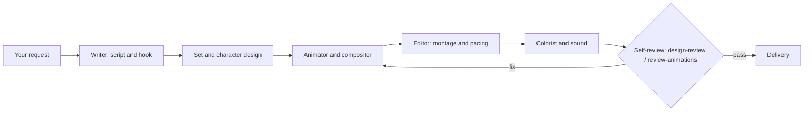

<div align="center">

<picture>
  <source media="(prefers-color-scheme: dark)" srcset="assets/hero/a-team-hero-dark.png">
  <source media="(prefers-color-scheme: light)" srcset="assets/hero/a-team-hero-light.png">
  
</picture>

# A-Team 2.0

**When the job needs specialists, you call the team.**

<a href="https://github.com/NEO849/a-team-2/actions/workflows/secret-scan.yml"></a>


<a href="LICENSE"></a>

[Install](#install) · [Meet the crew](#meet-the-crew) · [Skills](#skills) · [How the studio works](#how-the-studio-works) · [Built clean](#built-clean)

</div>

---

Most skill packs are a folder of prompts. This one is a **crew of specialists** — each one does a
single craft at a senior level. It is the curated public slice of a larger private system; every
file is scrubbed before it travels.

## Install

Two commands, then every skill, agent and command is available exactly like your own
project-local ones, namespaced under `a-team-2`:

```text
/plugin marketplace add NEO849/a-team-2
/plugin install a-team-2@neo849
```

Try it now:

```text
/design-craft a pricing page for a developer tool
/slop-check
/entscheiden build-vs-buy for our auth layer
```

## Meet the crew

16 subagents, each one craft. The glyph column is the planned portrait asset (rendered in a later
pass); the one-liner is grounded in that agent's own definition — follow the link to read it in full.

| Glyph (planned) | Role | What it does | Definition |
| --- | --- | --- | --- |
| `assets/crew/strategie-analyst.png` | **The Strategist** | Turns a hard-to-reverse call into a written GO / NO-GO / CONDITIONAL with explicit kill-criteria and "what would prove me wrong." | [`agents/strategie-analyst.md`](agents/strategie-analyst.md) |
| `assets/crew/recherche-scout.png` | **The Scout** | Finds the primary source — not the hype blog — and checks a claim against it before it gets repeated. | [`agents/recherche-scout.md`](agents/recherche-scout.md) |
| `assets/crew/surface-sweeper.png` | **The Sweeper** | Runs fast, cheap inventory sweeps across wide ground and returns only raw findings — no verdict, no analysis. | [`agents/surface-sweeper.md`](agents/surface-sweeper.md) |
| `assets/crew/computer-vision-modell-professor.png` | **The CV Professor** | Checks whether a vision model actually holds — accuracy, latency, size, license — on your data and runtime, not just a paper's leaderboard row. | [`agents/computer-vision-modell-professor.md`](agents/computer-vision-modell-professor.md) |
| `assets/crew/drehbuch-autor.png` | **The Writer** | Writes the script and the scene plan, built around a hook in the first three seconds. | [`agents/drehbuch-autor.md`](agents/drehbuch-autor.md) |
| `assets/crew/schnitt-editor.png` | **The Editor** | Owns the montage: builds the picture-locked cut and measures the cut rate (scene-detect) instead of guessing it. | [`agents/schnitt-editor.md`](agents/schnitt-editor.md) |
| `assets/crew/farb-spezialist.png` | **The Colorist** | Grades every shot to one consistent, BT.709-tagged look so avatar, graphics and background match. | [`agents/farb-spezialist.md`](agents/farb-spezialist.md) |
| `assets/crew/komponist.png` | **The Composer** | Writes original melodies, jingles and sing-along hooks, delivered as stems — never mixes or masters. | [`agents/komponist.md`](agents/komponist.md) |
| `assets/crew/songtexter-lyricist.png` | **The Lyricist** | Writes singable lyrics plus a syllable/stress map, built around one fixed hook and one swapped slot per round. | [`agents/songtexter-lyricist.md`](agents/songtexter-lyricist.md) |
| `assets/crew/sounddesigner.png` | **The Sound Designer** | Builds foley, ambience and reaction SFX as separate stems — everything except the music, and never the final mix. | [`agents/sounddesigner.md`](agents/sounddesigner.md) |
| `assets/crew/set-hintergrund-designer.png` | **The Set Designer** | Designs the depth-staggered background and props so the set never competes with the character for attention. | [`agents/set-hintergrund-designer.md`](agents/set-hintergrund-designer.md) |
| `assets/crew/character-designer.png` | **The Character Designer** | Fixes a character's palette, proportions, silhouette and signature pose on a model sheet before anything moves. | [`agents/character-designer.md`](agents/character-designer.md) |
| `assets/crew/figuren-animator.png` | **The Animator** | Rigs and animates drawn characters — lip-sync, blink timing, secondary motion — measured in frames, not eyeballed. | [`agents/figuren-animator.md`](agents/figuren-animator.md) |
| `assets/crew/avatar-compositor.png` | **The Compositor** | Composites a HeyGen avatar into full-screen or circular picture-in-picture without losing the alpha channel. | [`agents/avatar-compositor.md`](agents/avatar-compositor.md) |
| `assets/crew/pipeline-architekt.png` | **The Pipeline Architect** | Designs the module contracts and the render pipeline's JSON schema before anyone writes code. | [`agents/pipeline-architekt.md`](agents/pipeline-architekt.md) |
| `assets/crew/doku-autor.png` | **The Technical Writer** | Writes the maintenance guide so the next person can run and fix the pipeline without you. | [`agents/doku-autor.md`](agents/doku-autor.md) |

## Skills

38 skills across eight families, plus 5 standalone commands.

<details>
<summary><b>Design &amp; UI</b> — 10 skills that commit to an aesthetic and review it before it ships</summary>

`design-craft` · `advanced-design` · `apple-design` · `design-intel` · `design-review` · `emil-design-eng` · `pick-ui-library` · `prototype` · `ask-sonner` · `diagram-design`

</details>

<details>
<summary><b>Motion</b> — 7 skills for animation that survives a strict review</summary>

`motion-craft` · `animate` · `animate-expo` · `animation-vocabulary` · `find-animation-opportunities` · `improve-animations` · `review-animations`

</details>

<details>
<summary><b>Video &amp; slides</b> — 3 skills from deterministic Remotion renders to decks</summary>

`remotion-video` · `video-move` · `ppt-master`

</details>

<details>
<summary><b>Writing &amp; learning</b> — 2 skills plus the <code>/slop-check</code> command</summary>

`hype-check` · `lernmodus` · command `/slop-check`

</details>

<details>
<summary><b>Decisions &amp; science</b> — 4 skills that name the kill-criteria</summary>

`entscheiden` · `uncertainty-and-units` · `statistical-power` · `experimental-design`

</details>

<details>
<summary><b>Engineering</b> — 5 skills for test-first building and root-cause debugging</summary>

`build-tdd` · `debugging-and-error-recovery` · `commit-archaeologist` · `scope-creep-detector` · `write-swift`

</details>

<details>
<summary><b>Skill engineering &amp; prompting</b> — 4 skills that keep the library honest</summary>

`skill-forge` · `skill-harden` · `elite-prompt` · `ultimate-prompt` · commands `/skill-doctor`, `/skill-promote`

</details>

<details>
<summary><b>Security hygiene</b> — 3 read-only skills</summary>

`cve-intel` (offline CVE lookup) · `secret-validate` (credential validation) · `recon-parse` (scan-output parsing)

</details>

## How the studio works



<details>
<summary><b>Commands</b> — 5</summary>

| Command | What it does |
| --- | --- |
| `/slop-check` | flags AI-writing tells in a text |
| `/skill-doctor` | advisory right-sizing audit of the skill library |
| `/skill-promote` | shadow mode and red-team gate before a new skill ships |
| `/mc-scan` | static sweep for unguarded consequential actions in your own code |
| `/speedtest` | internet speed test |

</details>

## Built clean

- **No private data.** No infrastructure, credentials, internal paths or private references.
- **No-secrets gate** before every commit and push: `gitleaks` and `trufflehog` plus a denylist; CI repeats it on every push.
- **Self-contained.** No skill depends on anything outside this repository.

<details>
<summary><b>Third-party licences</b></summary>

Original work under [MIT](LICENSE). Bundled components keep their own licences — see
[THIRD_PARTY_LICENSES](THIRD_PARTY_LICENSES/): two adopted skills (`commit-archaeologist`,
`scope-creep-detector`) under Apache-2.0, the `ppt-master` icon sets under simple-icons (CC0-1.0),
Tabler (MIT) and Phosphor (MIT).

</details>

<details>
<summary><b>FAQ</b></summary>

<details>
<summary>Does it work without the rest of your private system?</summary>

Yes. Every skill, agent and command is self-contained and namespaced under <code>a-team-2</code>.

</details>

<details>
<summary>Is it production-ready?</summary>

It installs and works today; names and contents may still change while it is hardened (pre-release).

</details>

</details>

## Name & theme

A-Team 2.0 is an independent open-source project. It is **not affiliated with, endorsed by, or connected to** the television series "The A-Team" or its rights-holders. "A-Team" is used in its ordinary sense: a team of specialists you call for the job.

<sub>MIT © NEO849</sub>

<p align="right"><a href="#a-team-20">Back to top</a></p>
