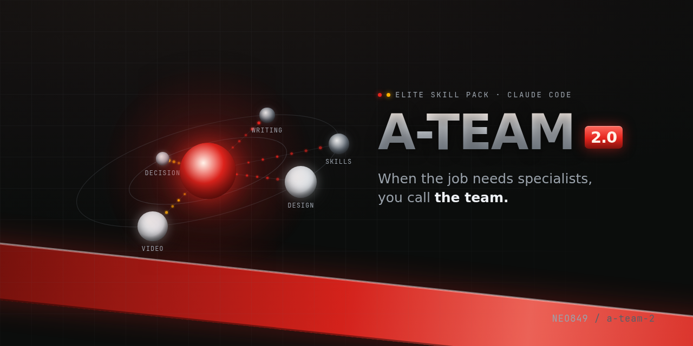

<div align="center">



# A-Team 2.0

**When the job needs specialists, you call the team.**

A curated, public pack of elite Claude Code skills and subagents — a full creative studio
and a decision crew, installable in one command.

[](LICENSE)
[](#built-clean)


</div>

---

Most skill packs are a folder of prompts. This one is a **team of specialists**, each with a
single craft it does at a senior level, and a review pass that argues with the work before it
ships. It is the curated public slice of a much larger private system: only the creative and
engineering craft travels, and every file is scrubbed clean before it goes anywhere.

## Why this is different

**A design director, not a theme.** The design family (`design-craft`, `advanced-design`,
`apple-design`, `design-intel`) doesn't hand you a template; it commits to an aesthetic world,
sets explicit design dials, and runs an adversarial visual-review pass (`design-review`) that
counts anti-slop violations before a pixel ships.

**A complete video studio, as agents.** Not one "make a video" prompt, but the division of labour
a real studio has: a director, editor, colorist, composer, lyricist, sound designer, background
artist, character designer, caption specialist and an independent QC lead — each a separate
subagent that only does, and judges, its own craft.

**An honest writing gate.** `slop-check` detects AI-writing tells and `humanize` rewrites them out,
on a detect → rewrite → re-check loop. `hype-check` verifies bold technical claims against primary
sources instead of repeating them. The output reads like a person wrote it, because the tells are
measured out.

**Decision frameworks that name the kill-criteria.** `entscheiden` and the strategy agent run a real
pipeline (pre-mortem, trade-offs, second-order effects, blast radius) and return a written
GO / NO-GO with the explicit "what would prove me wrong," not a confident guess.

**Skills that police themselves.** `skill-doctor`, `skill-harden`, `skill-forge` and
`scope-creep-detector` audit, red-team and right-size the pack's own skills — the discipline that
keeps a growing library from rotting.

## Install

```
/plugin marketplace add NEO849/a-team-2
/plugin install a-team-2@neo849
```

The repository is its own marketplace. Once installed, every skill, agent and command is available
exactly like your own project-local ones, namespaced under `a-team-2`.

Try one immediately:

```
/design-craft a pricing page for a developer tool
/slop-check            (on any text you just wrote)
/entscheiden           build-vs-buy for our auth layer
```

## What's inside

| Component | Count | Highlights |
|---|---|---|
| **Skills** (`skills/`) | 38 | design & motion (`design-craft`, `motion-craft`, `animate`), video (`remotion-video`, `video-move`), writing (`humanize`, `slop-check`, `hype-check`), decisions (`entscheiden`, `uncertainty-and-units`, `statistical-power`), skill-engineering (`skill-forge`, `skill-harden`), plus engineering & security-hygiene skills — `cve-intel` (offline CVE lookup), `secret-validate` (credential validation), `recon-parse` (scan-output parsing) |
| **Subagents** (`agents/`) | 16 | the video/creative production crew + a strategy analyst, a computer-vision model professor, a research scout and a fast inventory sweeper |
| **Commands** (`commands/`) | 5 | `/slop-check`, `/skill-doctor`, `/skill-promote`, `/mc-scan`, `/speedtest` |
| **Scripts** (`scripts/`) | stdlib-only | the engines the commands and skills call, path-relocatable via `${CLAUDE_PLUGIN_ROOT}` |

## Built clean

This pack was carved out of a much larger private library, so cleanliness is a feature, not a
footnote:

- **No private data.** No infrastructure, no credentials, no internal paths, no private references —
  every file was individually reviewed and generalized.
- **An automated no-secrets gate** runs before any commit or push: `gitleaks` + `trufflehog` pattern
  scanning plus a project denylist for private paths, handles and hosts. A single hit stops the push.
- **Self-contained.** Where a skill originally cited a private production script, the citation was
  generalized; no skill depends on anything outside this repo.

## Status

Pre-release and honest about it. The pack works and installs today; names and contents may still
change as it is hardened. Issues and suggestions welcome.

## License

[MIT](LICENSE) © NEO849

A few bundled third-party components keep their own licenses — see
[THIRD_PARTY_LICENSES](THIRD_PARTY_LICENSES/): two adopted skills under Apache-2.0, and the
`ppt-master` icon set (simple-icons) under CC0-1.0.

### Name & theme

A-Team 2.0 is an independent open-source project. It is **not affiliated with, endorsed by, or
connected to** the television series "The A-Team" or its rights-holders. "A-Team" is used here in
its ordinary, descriptive sense: a team of specialists you call for the job.
