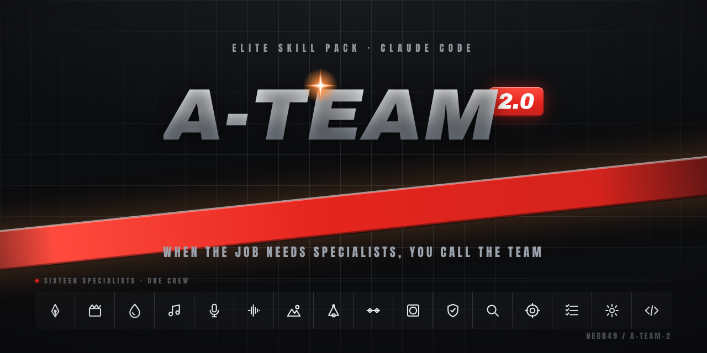
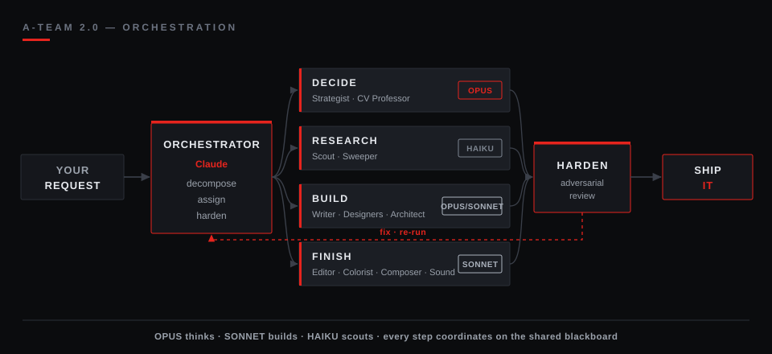

<div align="center">

<picture>
  <source media="(prefers-color-scheme: dark)" srcset="assets/hero/a-team-hero-dark.png">
  <source media="(prefers-color-scheme: light)" srcset="assets/hero/a-team-hero-light.png">
  
</picture>

# A-Team 2.0

**When the job needs specialists, you call the team.**

<table align="center">
<tr>
<td align="center" width="150"><h3>16</h3></td>
<td align="center" width="150"><h3>38</h3></td>
<td align="center" width="150"><h3>5</h3></td>
</tr>
<tr>
<td align="center">subagents</td>
<td align="center">skills</td>
<td align="center">commands</td>
</tr>
</table>

<a href="https://github.com/NEO849/a-team-2/actions/workflows/secret-scan.yml"></a>
&nbsp;

&nbsp;

&nbsp;

&nbsp;
<a href="LICENSE"></a>

[Install](#install) · [Meet the crew](#meet-the-crew) · [Skills](#skills) · [How the studio works](#how-the-studio-works) · [Built clean](#built-clean)

</div>

---

Most skill packs are a folder of prompts. This one is a **crew of specialists** — each one does a
single craft at a senior level. It is the curated public slice of a larger private system; every
file is scrubbed before it travels.

## Install

Two commands, then every skill, agent and command is available exactly like your own
project-local ones, namespaced under `a-team-2`:

```text
/plugin marketplace add NEO849/a-team-2
/plugin install a-team-2@neo849
```

Try it now:

```text
/design-craft a pricing page for a developer tool
/slop-check
/entscheiden build-vs-buy for our auth layer
```

## Meet the crew

16 subagents, one craft each. **Click a role to open its brief** — the model follows the job: Opus thinks, Sonnet builds, Haiku scouts. Every one-liner is grounded in that agent's own definition.

#### Decide & research

<details>
<summary><b>The Strategist</b></summary>

Turns a hard-to-reverse call into a written GO / NO-GO / CONDITIONAL with explicit kill-criteria and "what would prove me wrong."

`strategie-analyst` · runs on **Opus** · [definition](agents/strategie-analyst.md)

</details>

<details>
<summary><b>The CV Professor</b></summary>

Checks whether a vision model actually holds — accuracy, latency, size, license — on your data and runtime, not just a paper's leaderboard row.

`computer-vision-modell-professor` · runs on **Opus** · [definition](agents/computer-vision-modell-professor.md)

</details>

<details>
<summary><b>The Scout</b></summary>

Finds the primary source — not the hype blog — and checks a claim against it before it gets repeated.

`recherche-scout` · runs on **Haiku** · [definition](agents/recherche-scout.md)

</details>

<details>
<summary><b>The Sweeper</b></summary>

Runs fast, cheap inventory sweeps across wide ground and returns only raw findings — no verdict, no analysis.

`surface-sweeper` · runs on **Haiku** · [definition](agents/surface-sweeper.md)

</details>

#### Story & design

<details>
<summary><b>The Writer</b></summary>

Writes the script and the scene plan, built around a hook in the first three seconds.

`drehbuch-autor` · runs on **Opus** · [definition](agents/drehbuch-autor.md)

</details>

<details>
<summary><b>The Character Designer</b></summary>

Fixes a character's palette, proportions, silhouette and signature pose on a model sheet before anything moves.

`character-designer` · runs on **Opus** · [definition](agents/character-designer.md)

</details>

<details>
<summary><b>The Set Designer</b></summary>

Designs the depth-staggered background and props so the set never competes with the character for attention.

`set-hintergrund-designer` · runs on **Sonnet** · [definition](agents/set-hintergrund-designer.md)

</details>

<details>
<summary><b>The Pipeline Architect</b></summary>

Designs the module contracts and the render pipeline's JSON schema before anyone writes code.

`pipeline-architekt` · runs on **Opus** · [definition](agents/pipeline-architekt.md)

</details>

#### Animate & composite

<details>
<summary><b>The Animator</b></summary>

Rigs and animates drawn characters — lip-sync, blink timing, secondary motion — measured in frames, not eyeballed.

`figuren-animator` · runs on **Sonnet** · [definition](agents/figuren-animator.md)

</details>

<details>
<summary><b>The Compositor</b></summary>

Composites a HeyGen avatar into full-screen or circular picture-in-picture without losing the alpha channel.

`avatar-compositor` · runs on **Sonnet** · [definition](agents/avatar-compositor.md)

</details>

#### Finish

<details>
<summary><b>The Editor</b></summary>

Owns the montage: builds the picture-locked cut and measures the cut rate (scene-detect) instead of guessing it.

`schnitt-editor` · runs on **Sonnet** · [definition](agents/schnitt-editor.md)

</details>

<details>
<summary><b>The Colorist</b></summary>

Grades every shot to one consistent, BT.709-tagged look so avatar, graphics and background match.

`farb-spezialist` · runs on **Sonnet** · [definition](agents/farb-spezialist.md)

</details>

<details>
<summary><b>The Composer</b></summary>

Writes original melodies, jingles and sing-along hooks, delivered as stems — never mixes or masters.

`komponist` · runs on **Sonnet** · [definition](agents/komponist.md)

</details>

<details>
<summary><b>The Lyricist</b></summary>

Writes singable lyrics plus a syllable/stress map, built around one fixed hook and one swapped slot per round.

`songtexter-lyricist` · runs on **Sonnet** · [definition](agents/songtexter-lyricist.md)

</details>

<details>
<summary><b>The Sound Designer</b></summary>

Builds foley, ambience and reaction SFX as separate stems — everything except the music, and never the final mix.

`sounddesigner` · runs on **Sonnet** · [definition](agents/sounddesigner.md)

</details>

#### Document

<details>
<summary><b>The Technical Writer</b></summary>

Writes the maintenance guide so the next person can run and fix the pipeline without you.

`doku-autor` · runs on **Sonnet** · [definition](agents/doku-autor.md)

</details>

## Skills

38 skills across eight families, plus 5 standalone commands.

<details>
<summary><b>Design &amp; UI</b> — 10 skills that commit to an aesthetic and review it before it ships</summary>

`design-craft` · `advanced-design` · `apple-design` · `design-intel` · `design-review` · `emil-design-eng` · `pick-ui-library` · `prototype` · `ask-sonner` · `diagram-design`

</details>

<details>
<summary><b>Motion</b> — 7 skills for animation that survives a strict review</summary>

`motion-craft` · `animate` · `animate-expo` · `animation-vocabulary` · `find-animation-opportunities` · `improve-animations` · `review-animations`

</details>

<details>
<summary><b>Video &amp; slides</b> — 3 skills from deterministic Remotion renders to decks</summary>

`remotion-video` · `video-move` · `ppt-master`

</details>

<details>
<summary><b>Writing &amp; learning</b> — 2 skills plus the <code>/slop-check</code> command</summary>

`hype-check` · `lernmodus` · command `/slop-check`

</details>

<details>
<summary><b>Decisions &amp; science</b> — 4 skills that name the kill-criteria</summary>

`entscheiden` · `uncertainty-and-units` · `statistical-power` · `experimental-design`

</details>

<details>
<summary><b>Engineering</b> — 5 skills for test-first building and root-cause debugging</summary>

`build-tdd` · `debugging-and-error-recovery` · `commit-archaeologist` · `scope-creep-detector` · `write-swift`

</details>

<details>
<summary><b>Skill engineering &amp; prompting</b> — 4 skills that keep the library honest</summary>

`skill-forge` · `skill-harden` · `elite-prompt` · `ultimate-prompt` · commands `/skill-doctor`, `/skill-promote`

</details>

<details>
<summary><b>Security hygiene</b> — 3 read-only skills</summary>

`cve-intel` (offline CVE lookup) · `secret-validate` (credential validation) · `recon-parse` (scan-output parsing)

</details>

<details>
<summary><b>Commands</b> — 5 standalone slash-commands</summary>

| Command | What it does |
| --- | --- |
| `/slop-check` | flags AI-writing tells in a text |
| `/skill-doctor` | advisory right-sizing audit of the skill library |
| `/skill-promote` | shadow mode and red-team gate before a new skill ships |
| `/mc-scan` | static sweep for unguarded consequential actions in your own code |
| `/speedtest` | internet speed test |

</details>

## How the studio works

You call the team. An orchestrator decomposes the job, fans it out to the specialists that fit, and nothing ships until it survives an adversarial review.

<div align="center">
<picture>
  <source media="(prefers-color-scheme: dark)" srcset="assets/diagram/pipeline-dark.svg">
  <source media="(prefers-color-scheme: light)" srcset="assets/diagram/pipeline-light.svg">
  
</picture>
</div>

## Built clean

- **No private data.** No infrastructure, credentials, internal paths or private references.
- **No-secrets gate** before every commit and push: `gitleaks` and `trufflehog` plus a denylist; CI repeats it on every push.
- **Self-contained.** No skill depends on anything outside this repository.

<details>
<summary><b>Third-party licences</b></summary>

Original work under [MIT](LICENSE). Bundled components keep their own licences — see
[THIRD_PARTY_LICENSES](THIRD_PARTY_LICENSES/): two adopted skills (`commit-archaeologist`,
`scope-creep-detector`) under Apache-2.0, the `ppt-master` icon sets under simple-icons (CC0-1.0),
Tabler (MIT) and Phosphor (MIT).

</details>

<details>
<summary><b>FAQ</b></summary>

<details>
<summary>Does it work without the rest of your private system?</summary>

Yes. Every skill, agent and command is self-contained and namespaced under <code>a-team-2</code>.

</details>

<details>
<summary>Is it production-ready?</summary>

It installs and works today; names and contents may still change while it is hardened (pre-release).

</details>

</details>

## Name & theme

A-Team 2.0 is an independent open-source project. It is **not affiliated with, endorsed by, or connected to** the television series "The A-Team" or its rights-holders. "A-Team" is used in its ordinary sense: a team of specialists you call for the job.

<sub>MIT © NEO849</sub>

<p align="right"><a href="#a-team-20">Back to top</a></p>
